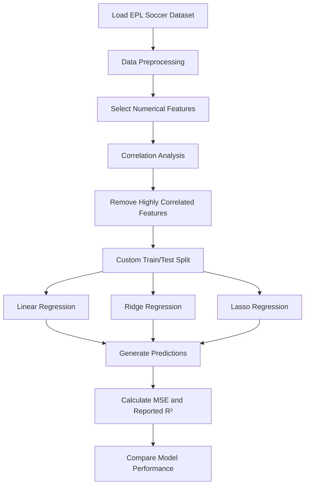

# Regression-Models-from-Scratch

# 🤖 Regression Models from Scratch using NumPy


> A machine learning project that builds **Linear Regression, Ridge Regression, and Lasso Regression from scratch using NumPy**. Using English Premier League (EPL) soccer player data, the project explores gradient descent, regularization, feature selection, multicollinearity, and regression model evaluation without relying on ready-made regression estimators.

---

## 📌 Project Overview

Linear regression is one of the fundamental algorithms in machine learning. Understanding how it works internally provides a strong foundation for learning more advanced predictive models.

This project implements three regression models using custom Python classes and NumPy-based mathematical operations. Instead of simply importing a prebuilt regression algorithm, the notebook develops the core training and prediction logic step by step.

The models are trained on an EPL soccer player dataset to predict player scores using numerical player characteristics and performance-related variables.

### 🎯 Project Objectives

- Understand the mathematical foundations of linear regression.
- Implement regression models from scratch using NumPy.
- Understand gradient descent and model parameter updates.
- Explore L1 and L2 regularization.
- Detect and reduce multicollinearity among input features.
- Implement a custom train/test split function.
- Evaluate and compare model performance using Mean Squared Error (MSE) and the notebook's reported R² score.

---

## 📂 Dataset

**Dataset:** `EPL_Soccer_MLR_LR.csv`

The project uses English Premier League soccer player data containing player attributes, performance indicators, financial information, and a target score.

### 📊 Important Features

| Feature | Description |
|---|---|
| `DistanceCovered(InKms)` | Distance covered by a player per game |
| `Goals` | Average goals per game |
| `MinutestoGoalRatio` | Minutes-to-goal ratio |
| `ShotsPerGame` | Average shots per game |
| `AgentCharges` | Player agent charges |
| `BMI` | Body Mass Index |
| `Cost` | Player cost |
| `PreviousClubCost` | Previous club cost |
| `Height` | Player height |
| `Weight` | Player weight |
| `Score` | Target variable to predict |

The categorical columns `PlayerName` and `Club` are excluded from the numerical modeling workflow.

---

## 🔄 Machine Learning Workflow



---

## 🧹 1. Data Preprocessing

Before training the regression models, the dataset is prepared for numerical computation.

### Missing-value handling

The notebook removes rows that are entirely empty and selects numerical columns for modeling.

```python
df.dropna(
    axis=0,
    how="all",
    inplace=True
)

new_df = df.select_dtypes(["number"])
```

After this step, the dataset contains **202 non-empty observations**.

### Feature and target separation

The input features are represented by `X`, while the target variable is represented by `y`.

```python
X = new_df.iloc[:, :-1]
y = new_df.iloc[:, -1]
```

The target variable is `Score`, which the models learn to predict from the remaining numerical features.

---

## 🔗 2. Correlation Analysis and Multicollinearity

Highly correlated input features may provide overlapping information and make regression coefficients harder to interpret.

The notebook calculates a correlation matrix and identifies feature pairs whose absolute correlation exceeds `0.80`.

```python
correlation_matrix = X.corr()

# Identify highly correlated feature pairs
if abs(correlation_matrix.iloc[i, j]) > 0.8:
    correlated_features.add(correlation_matrix.columns[i])
```

The following features are identified and removed in the notebook:

- `Height`
- `MinutestoGoalRatio`
- `Weight`
- `ShotsPerGame`

This reduces the number of input features from **10 to 6**, helping simplify the regression models.

---

## ✂️ 3. Custom Train/Test Split

Rather than using a ready-made splitting utility, the notebook implements its own functions to shuffle the data and divide it into training and testing sets.

```python
def shuffle_data(X, y, seed=None):
    if seed:
        np.random.seed(seed)

    idx = np.arange(X.shape[0])
    np.random.shuffle(idx)

    try:
        return X[idx], y[idx]
    except:
        return X.iloc[idx], y.iloc[idx]
```

A custom `train_test_split()` function then divides the shuffled observations according to a specified test fraction.

### Configuration

| Parameter | Value |
|---|---|
| Dataset observations | 202 |
| Test size | 20% |
| Training size | 80% |
| Random seed | 42 |

Using a fixed seed makes the split reproducible for the same data and implementation.

---

## 🧠 4. Regression Models Implemented from Scratch

The notebook defines separate Python classes for the three regression models. Each class includes a training method (`fit()`) and a prediction method (`predict()`).

### 📈 A. Linear Regression

Linear regression models the relationship between input variables and a continuous target.

Its prediction equation is:

\[
\hat{y} = Xw + b
\]

Where:

- \(X\) represents the input features.
- \(w\) represents the learned weights.
- \(b\) represents the bias.
- \(\hat{y}\) represents the predicted score.

**Implementation highlights:**

- Initializes weights and bias.
- Generates predictions using NumPy operations.
- Computes gradients of the prediction error.
- Updates the parameters through gradient descent.
- Generates predictions for unseen test data.

The model is implemented using a custom `LinearRegression` class rather than a prebuilt estimator.

### 🛡️ B. Ridge Regression — L2 Regularization

Ridge regression adds an L2 penalty to the regression objective to discourage excessively large coefficients.

A simplified form of its objective is:

\[
J(w)=\frac{1}{n}\sum_{i=1}^{n}(y_i-\hat{y}_i)^2
+\lambda\sum_{j=1}^{p}w_j^2
\]

The regularization strength controls how strongly large coefficients are penalized.

**Key concepts:**

- L2 regularization
- Weight shrinkage
- Gradient-based optimization
- Reducing model complexity
- Managing the effects of correlated predictors

The notebook implements a custom `RidgeRegression` class with configurable `alpha`, learning rate, and number of iterations.

### 🎯 C. Lasso Regression — L1 Regularization

Lasso regression introduces an L1 penalty based on the absolute values of the coefficients.

Its conceptual objective is:

\[
J(w)=\frac{1}{n}\sum_{i=1}^{n}(y_i-\hat{y}_i)^2
+\lambda\sum_{j=1}^{p}|w_j|
\]

Unlike Ridge, Lasso can drive some coefficients exactly to zero when optimized with a suitable L1 implementation, making it useful for feature selection.

**Key concepts:**

- L1 regularization
- Coefficient shrinkage
- Sparse model behavior
- Feature selection
- Trade-offs between prediction error and model complexity

The notebook defines a custom `LassoRegression` class and compares its predictions with those of Linear and Ridge Regression.

---

## ⚙️ 5. Gradient Descent

Gradient descent is an optimization algorithm that improves model parameters iteratively to reduce prediction error.

The general update rule is:

\[
w_{\text{new}}=w_{\text{old}}-\eta\nabla_w J(w)
\]

Where:

- \(w\) represents model weights.
- \(\eta\) represents the learning rate.
- \(\nabla_w J(w)\) represents the gradient of the objective function.

The custom model classes use iterative parameter updates rather than relying on a ready-made regression optimizer.

### Model configuration

| Model | Learning rate | Iterations | Regularization strength |
|---|---:|---:|---:|
| Linear Regression | 0.00001 | 100 | Not applicable |
| Ridge Regression | 0.00001 | 100 | 0.03 |
| Lasso Regression | 0.00001 | 100 | 0.03 |

These values reflect the settings used in the notebook, not necessarily the optimal values for every dataset.

---

## 📏 6. Model Evaluation

The notebook evaluates the models using Mean Squared Error and a custom score labelled R².

### Mean Squared Error (MSE)

MSE measures the average squared difference between the actual and predicted values.

\[
MSE=\frac{1}{n}\sum_{i=1}^{n}(y_i-\hat{y}_i)^2
\]

A lower MSE indicates smaller squared prediction errors.

### R² Score

R² is commonly used to assess how well a regression model explains variation in the target variable.

The notebook implements its own `r2_score()` function using the squared correlation between actual and predicted values. This is an R²-like measure and is not always equivalent to the standard coefficient-of-determination formula.

---

## 📊 Results

The following values are taken from the notebook's recorded evaluation outputs.

| Model | MSE ↓ | Reported R²-like score ↑ |
|---|---:|---:|
| Linear Regression | 4.2881 | 0.9316 |
| Lasso Regression | **2.8497** | **0.9480** |
| Ridge Regression | **2.8497** | **0.9480** |

*The reported score is the notebook's squared-correlation calculation; the standard scikit-learn R² metric may produce different values.*

### 🔍 Observations

- Lasso and Ridge have lower reported MSE than the Linear Regression model in this run.
- Lasso and Ridge produce nearly identical reported scores.
- The results illustrate why regularization methods are worth comparing when building regression models.
- These results reflect one dataset split and the notebook's chosen hyperparameters; they are not a guarantee of performance on other data.

---

## 🛠️ Tech Stack

| Technology | Purpose |
|---|---|
| **Python** | Programming language |
| **NumPy** | Numerical computation, arrays, matrix operations, and gradient calculations |
| **Pandas** | Dataset loading and preprocessing |
| **Jupyter Notebook** | Development, experiments, and documentation |

**Core emphasis:** implementing regression logic with NumPy instead of relying on prebuilt Linear, Ridge, or Lasso regression estimators.

---

## 📁 Repository Structure

```text
Regression-Models-from-Scratch/
│
├── 📓 Regression_Models_comp.ipynb
├── 📊 EPL_Soccer_MLR_LR.csv
└── 📄 README.md
```

---

## 🚀 How to Run

### Option 1 — Google Colab

1. Open Google Colab.
2. Upload `Regression_Models_comp.ipynb`.
3. Upload `EPL_Soccer_MLR_LR.csv` if using the local CSV-loading cell.
4. Run the notebook cells in order.

### Option 2 — Run Locally

Clone the repository:

```bash
git clone https://github.com/YOUR_USERNAME/Regression-Models-from-Scratch.git
cd Regression-Models-from-Scratch
```

Install the required libraries:

```bash
pip install numpy pandas jupyter
```

Launch Jupyter Notebook:

```bash
jupyter notebook
```

Open `Regression_Models_comp.ipynb` and execute the cells sequentially. Ensure the CSV file path in the data-loading cell points to the location of `EPL_Soccer_MLR_LR.csv`.

---

## 💡 Key Learning Outcomes

By completing this project, I gained practical experience with:

- Implementing machine learning algorithms from scratch.
- Understanding the mathematics behind linear regression.
- Writing reusable model classes using Python OOP.
- Performing gradient-based optimization.
- Understanding L1 and L2 regularization concepts.
- Exploring feature correlation and multicollinearity.
- Building a custom data-shuffling and train/test splitting workflow.
- Generating predictions from custom model implementations.
- Evaluating regression models with MSE and an R²-like score.
- Comparing alternative models using the same dataset and test observations.

---

## 🔬 Future Improvements

Potential extensions to strengthen the project include:

- Validate the Lasso gradient against the mathematical derivative of the L1 penalty.
- Compare custom implementations with `sklearn.linear_model.LinearRegression`, `Ridge`, and `Lasso`.
- Use the standard `sklearn.metrics.r2_score` function alongside the existing custom score.
- Experiment with learning rates, iteration counts, and regularization strengths.
- Add feature scaling and cross-validation.
- Visualize actual versus predicted scores and residual distributions.
- Track how coefficients change with different regularization strengths.

These improvements would help validate the custom implementations and make model comparisons more robust.

---

## 🎓 Interview-Relevant Concepts

**What does gradient descent do?**  
It iteratively updates model parameters using gradients to reduce the objective function.

**Why use Ridge Regression?**  
Ridge adds an L2 penalty that discourages large coefficients and can help manage overfitting.

**How does Lasso differ from Ridge?**  
Lasso uses an L1 penalty and can produce zero coefficients, while Ridge uses an L2 penalty and generally shrinks coefficients toward zero.

**What is multicollinearity?**  
It occurs when input features are strongly linearly related, which can make regression coefficients less stable or harder to interpret.

**Why split data into training and testing sets?**  
The training set is used to fit the model, while the test set helps assess how the model performs on observations not used for training.

**Why implement a model from scratch?**  
It helps develop a deeper understanding of the underlying mathematics, optimization process, and parameter updates that ready-made libraries normally handle internally.

---

## 👨‍💻 Author

**Ambuj Tripathi**  
B.Tech — Electronics & Computer Science  
Ramdeobaba University, Nagpur

Interested in **Artificial Intelligence, Machine Learning, Deep Learning, NLP, and Data Science**.

---

## ⭐ Support

If you found this project useful for learning machine learning fundamentals, NumPy, or regression algorithms, consider giving the repository a ⭐.

### 🏷️ Topics

`python` `numpy` `pandas` `machine-learning` `linear-regression` `ridge-regression` `lasso-regression` `gradient-descent` `regularization` `multicollinearity` `optimization` `object-oriented-programming` `from-scratch` `jupyter-notebook` `epl-soccer`
